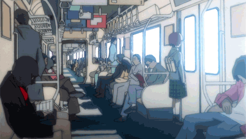

<h1 align="center">Welcome to My GitHub Bonita</h1>
<h3 align="center">Systems Engineer · Researcher · Computational Neuroscience Fan</h3>

  

---

### About Me

Hi I'm a systems engineer jej LKJAKSLDJLF.
---

### Tech Stack

  

---

  
   
  
   
  

---

### Connect With Me

- Ig: [Ar3lyXl](https://www.instagram.com/ar3lyx1_/)
- LinkedIn: [Andry Caceres](https://www.linkedin.com/in/andry-caceres-439504331)  
- Twitter/X: [@ADY_X1](https://x.com/ADY_X1)  
- Email: andry.caceres@estudiante.ucsm.edu.pe

---

  

  <strong>UN SALUDO A LA GRASA</strong>

